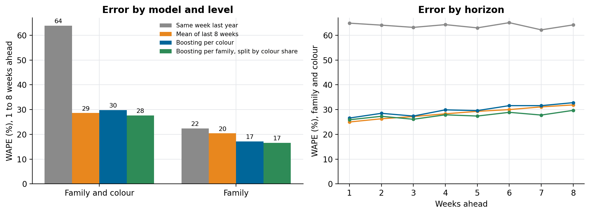
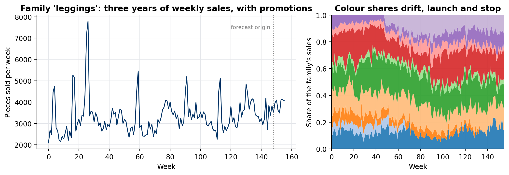

# Weekly demand forecast

Weekly demand forecast by product family and colour for a textile manufacturer, on synthetic sales: four methods compared in a rolling-origin backtest, 1 to 8 weeks ahead, at the level planners use.

Companion code for the article **[Weekly demand forecasting for a manufacturer](https://lucas.rangeltech.net/articles/h13-weekly-demand-forecasting/)**.

## The problem

A manufacturer plans production weeks ahead and needs to know how much of each product family, in each colour, will sell in each of the next eight weeks. Families are stable; colours move with fashion, are launched and discontinued, and their weekly series are small and noisy.

> All data in this repository is synthetic, generated by `forecast.py` with a fixed seed. No client data, names or code are included.

## What the code does

- **Generates three years of weekly sales** for 10 product families with winter or summer peaks, a slow trend and promotions, split into 4 to 10 colours each with drifting shares, launches and discontinuations, and over-dispersed weekly counts (82 family-colour series).
- **Forecasts 1 to 8 weeks ahead from 14 origins** over the last six months, using only data known at each origin.
- **Compares four methods:**
  1. same week last year;
  2. mean of the last 8 weeks;
  3. one global gradient-boosting model (Poisson loss) for every family-colour series, with lags, the same week last year, week of year and horizon as features (a direct multi-horizon model);
  4. the same model at family level, split into colours by each colour's share of the last 8 weeks.
- **Scores** with WAPE and bias at family-and-colour level and summed to family level.

## Results

| Method | WAPE, family and colour | WAPE, family | Bias |
|---|---:|---:|---:|
| Same week last year | 64% | 22% | +4% |
| Mean of last 8 weeks | 29% | 20% | −7% |
| Boosting per colour | 30% | 17% | −5% |
| Boosting per family, split by colour share | 28% | 17% | +3% |





## Run it

Python 3.11 or later.

```bash
pip install -r requirements.txt
python forecast.py
python figures.py figures
```

## Files

| File | What it is |
|---|---|
| `forecast.py` | data generator, the four methods and the backtest; writes `results.json` |
| `figures.py` | the figures |
| `results.json` | the numbers above, including error by horizon |

## License

Apache 2.0. See [LICENSE](LICENSE).
